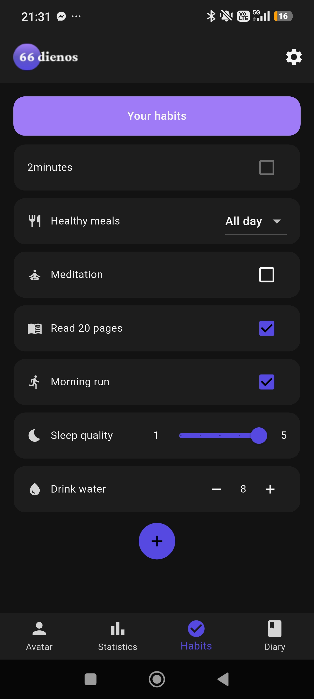

# Well-Being App (Saviugdymo programėlė)

A Flutter + Firebase mobile app for self-improvement: track habits, keep a mood diary, see your progress in charts, and grow a collection of virtual pets as you go.

<!-- TODO: add 3–4 screenshots or a short GIF here, e.g.  -->

## Features

- **Habits and goals**: create habits, log them daily, set goals and track progress toward them. An onboarding questionnaire suggests starter habits.
- **Diary**: daily entries with mood, guided questions and photos, plus a calendar view, a "memories" tab and a before/after photo comparison.
- **Statistics**: mood and habit charts over time (fl_chart), including a monthly overview.
- **Pets and rewards**: earn XP and daily and level-up rewards, unlock and level up pets, and collect skins.
- **Step tracking**: reads daily steps from Health Connect.
- **Push notifications**: Firebase Cloud Messaging.
- **Personalisation**: light and dark themes and Lithuanian/English language, saved per user.
- **Google sign-in**: Firebase Authentication, with user data stored in Cloud Firestore and images in Firebase Storage.

## Tech stack

Flutter (Dart) · Firebase Auth · Cloud Firestore · Firebase Storage · Firebase Cloud Messaging · Provider · fl_chart · health (Health Connect)

## Project structure

```
lib/
  data/        models and Firestore repositories (users, pets, diary, quotes)
  features/    habits feature (models, repository, dialogs, utils)
  pages/       screens (avatar & collection, statistics, habits, diary, settings, login)
  services/    auth, rewards, notifications, steps, theme, language, sounds
  widgets/     shared UI components and charts
  theme/       app themes
```

## My contribution

This was a 4-person university team project. I worked on:

<!-- TODO: fill in what you built yourself. Examples based on your commits:
- Connected the app to Firebase and built the automated tasks
- Daily and level-up rewards and the collection log
- Login and collection screens
- Saving the selected theme to the database, English language support, mood chart
-->

Team: <!-- TODO: add teammates' GitHub profiles, e.g. [Rokiz12](https://github.com/Rokiz12), [lukkool](https://github.com/lukkool), TautvydasIT -->
Original repository: <!-- TODO: link it here if it's public, e.g. https://github.com/Rokiz12/Saviugdymo_Programele -->

## Tests

```bash
flutter test
```

Unit tests cover the habit models and goal-progress logic (`test/habits/`).

## Running locally

Firebase config files are not committed. To run the app with your own Firebase project:

1. Install [Flutter](https://docs.flutter.dev/get-started/install) (Dart SDK 3.11+).
2. Create a Firebase project and enable **Authentication (Google)**, **Cloud Firestore**, **Storage** and **Cloud Messaging**.
3. Generate the config with the [FlutterFire CLI](https://firebase.google.com/docs/flutter/setup):
   ```bash
   flutterfire configure
   ```
   This creates `android/app/google-services.json` and `lib/firebase_options.dart` (see `lib/firebase_options.example.dart` for the format).
4. Copy `lib/services/auth_service.example.dart` to `lib/services/auth_service.dart` and set `serverClientId` to your project's **Web client ID**.
5. Add your debug SHA-1 fingerprint to the Firebase Android app (needed for Google sign-in).
6. Run:
   ```bash
   flutter pub get
   flutter run
   ```

<!-- TODO: note the Firestore data the app expects to already exist (e.g. `pets`, `quotes`, `diaryQuestions` collections), or include a seed script. -->

Diary questions live in the `diaryQuestions` collection. Each document has a Lithuanian `question` field and an optional English `question_en` field; when English is selected and `question_en` is missing, the Lithuanian text is shown.
